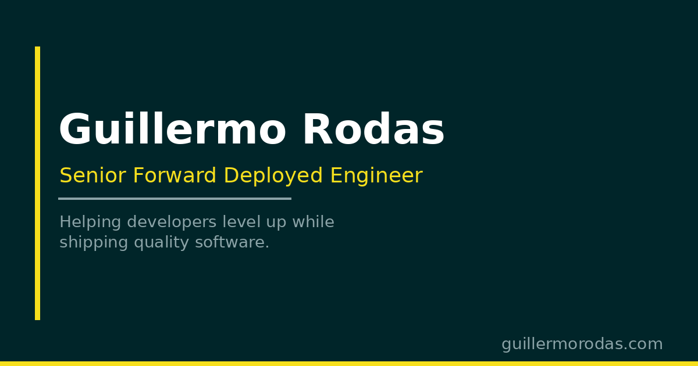

# Guillermo Rodas

**Personal site with courses, writing, side projects and contact, in English and Spanish.**

[](https://github.com/glrodasz/website/actions/workflows/tokens-audit.yml)    [](https://guillermorodas.com/components/)

<br clear="left">

[**Live site**](https://guillermorodas.com) · [Storybook](https://guillermorodas.com/components/) · [Token explorer](https://guillermorodas.com/tokens) · [What's on the site](#whats-on-the-site) · [Quick start](#quick-start)



## Why

Guillermo Rodas is a Senior Forward Deployed Engineer and community lead who helps companies build quality products and shares what he learns with the Spanish-speaking developer community. [guillermorodas.com](https://guillermorodas.com) is the hub that ties that work together: his courses, his writing on [blog.guillermorodas.com](https://blog.guillermorodas.com), the side projects he builds, and the right channel to reach him.

The site doubles as a showcase of how he builds front ends: every visual value comes from the **Quantum Design** token system, every component is documented in Storybook, and every page ships in English and Spanish.

## What's on the site

| Page | Route | What it shows |
|---|---|---|
| Home | `/` | Hero, a preview of the latest course and the most recent blog posts |
| Courses | `/courses` | AI-First Programming waitlist, free YouTube courses, Garaje Code Pills tutorials, courses on other platforms |
| Projects | `/projects` | Side projects and community sites, with screenshots and share links |
| My history | `/about/history` | Career story, long-form Markdown |
| Lifestyle | `/about/lifestyle` | Favorite books, films, series and anime |
| Contact | `/contact` | Which channel to use for what |

Every route also lives under `/es` (for example `/es/courses`).

### Home

A hero introducing Guillermo as a technical partner for building better products, a preview of the latest course, and recent posts pulled from the blog.

### Courses

- **AI-First Programming**: an upcoming paid course on building software with AI as the primary tool, across JavaScript/TypeScript, Python, Go and Rust, in short focused video lessons. A waitlist form is open.
- **Free courses**: full YouTube playlists, no paywall.
- **Tutorials**: Garaje Code Pills, short practical videos on YouTube.
- **Courses on other platforms**: a curated list of courses published elsewhere.

### Projects

Things Guillermo built for fun, to learn something new, or because he needed them (Walleto, Haggler, Nido, Timepass and more), plus the community sites he runs, such as Undefined Academy.

### About: My history

From modifying Blogger templates as a teenager, through university, Java, full-stack JavaScript, developer communities, agencies, startups and international teams.

### About: Lifestyle

A curated selection of books, films, series and anime, linked to Goodreads, Letterboxd, IMDb and MyAnimeList.

### Contact

| You want to | Channel |
|---|---|
| Say hi or ask a quick question | Twitter or Instagram |
| Work on a project together | Email |
| Talk about a job offer or career advice | LinkedIn |

Guillermo writes in Spanish on Twitter, and in English on Bluesky, Threads and Mastodon.

## Quick start

Prerequisites: Node.js 25 (see `.nvmrc`) and [pnpm](https://pnpm.io).

```bash
git clone https://github.com/glrodasz/website.git
cd website
pnpm install
pnpm dev
```

`pnpm dev` builds the design tokens and the blog post list, then starts Vite on [localhost:5173](http://localhost:5173). The blog posts come from the live RSS feed; offline, the last generated list is kept.

<details>
<summary>All scripts</summary>

| Script | What it does |
|---|---|
| `pnpm dev` | Build tokens and posts, then start the Vite dev server |
| `pnpm build` | Build tokens and posts, type-check, build the site and the Storybook into `dist/` |
| `pnpm preview` | Serve the production build |
| `pnpm storybook` | Start Storybook on port 6006 |
| `pnpm lint` | Run ESLint |
| `pnpm build:tokens` | Regenerate `src/tokens/design-tokens.css` from the token JSON |
| `pnpm audit:tokens` | Audit token JSON and CSS usage; fails on any error or warning |
| `pnpm build:posts` | Fetch the English and Spanish blog RSS feeds into `src/generated/` |
| `pnpm build:covers` | Download and optimize the Lifestyle cover images |
| `pnpm build:screenshots` | Capture screenshots of the projects with Playwright |

</details>

## How it works

- **Content is data.** Courses, projects, socials and Lifestyle picks live in typed files under `src/data/`; the career story is Markdown in `src/content/history.md` and `history.es.md`; UI copy lives in `src/locales/{en,es}/`.
- **Blog posts are fetched at build time.** `scripts/build-posts.ts` reads the English and Spanish RSS feeds of blog.guillermorodas.com and writes them to `src/generated/`, so the site never calls the blog from the browser.
- **Two languages, one set of routes.** English is served at `/`, Spanish under `/es`. On a first visit Vercel sends Spanish-speaking browsers to `/es` based on `Accept-Language`; once a visitor picks a language, a `locale` cookie wins.
- **One serverless function.** `api/subscribe.ts` adds AI-First Programming waitlist sign-ups to the Brevo list for the visitor's language.
- **Design tokens drive every style.** Token JSON in `src/tokens/json/` follows a three-level hierarchy (global → system → component) in the W3C DTCG format and compiles to CSS custom properties. Component CSS only uses component tokens; light and dark themes swap the system level.

**Tech stack:** React 19 · TypeScript · Vite · React Router · i18next · Storybook · Quantum Design tokens · Vercel (hosting and serverless function) · Simple Analytics

## Configuration

Copy `.env.example` to `.env.local` and fill in what you need.

| Variable | Used by | Purpose |
|---|---|---|
| `VITE_SITE_URL` | Site | Production origin for canonical URLs and social cards |
| `BREVO_API_KEY` | `api/subscribe.ts` | Brevo API key for the waitlist |
| `BREVO_AI_COURSE_LIST_ID_EN` | `api/subscribe.ts` | Brevo list for English sign-ups |
| `BREVO_AI_COURSE_LIST_ID_ES` | `api/subscribe.ts` | Brevo list for Spanish sign-ups |

The Brevo variables are server-only and only matter for the waitlist form.

### Project layout

```
api/                 Vercel serverless function (waitlist sign-up)
public/              Static assets: favicon, OG image, covers, logos
scripts/             Build scripts: posts, covers, screenshots, token audit
src/
├── components/      Atomic Design: atoms, molecules, organisms
├── content/         Long-form Markdown (career history, EN and ES)
├── data/            Courses, projects, socials, Lifestyle picks
├── locales/         UI copy in en/ and es/
├── pages/           Route components; pages/tokens is the token explorer
└── tokens/          Token JSON, build script and generated CSS
```

## Documentation

| Doc | What's in it |
|---|---|
| [CLAUDE.md](CLAUDE.md) | Full development guide: token hierarchy, naming, component and Storybook conventions |
| [AGENTS.md](AGENTS.md) | Quick-reference rules for the token hierarchy |
| [Storybook](https://guillermorodas.com/components/) | Every component with its variants and states |
| [Token explorer](https://guillermorodas.com/tokens) | Browse global, system and component tokens and the audit results |

## Contributing

| To add | Edit | Then |
|---|---|---|
| A side project | `src/data/funProjects.ts` | `pnpm build:screenshots -- <slug>` to capture its screenshot |
| A book, film, series or anime | `src/data/lifestyle.ts` and the list in `scripts/download-covers.ts` | `pnpm build:covers` |
| UI copy | `src/locales/en/` and `src/locales/es/` | Keep both languages in sync |
| A color, spacing or type value | `src/tokens/json/` | `pnpm build:tokens`, then `pnpm audit:tokens` |
| A component | `src/components/<level>/` with its CSS and story | `pnpm storybook` |

CSS uses `--components-tokens--*` variables only, never raw values; [CLAUDE.md](CLAUDE.md) has the full rules. CI runs the token audit on every pull request and on pushes to `main`, and it must report 0 errors and 0 warnings.

## License

© 2026 Guillermo Rodas. All rights reserved.

Cover images on the Lifestyle page come from Open Library and TMDB.
